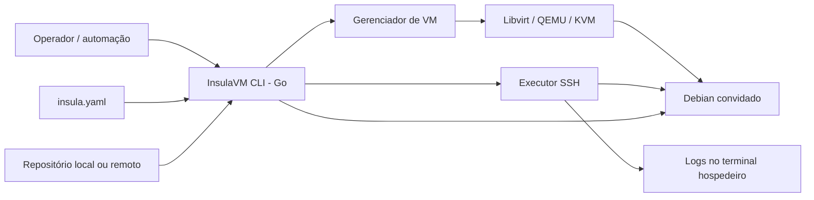

<!-- A-BIOMA-DOC-STANDARD -->
<!-- A-BIOMA-DOC-REVISADO -->

# ARQ-001 — Arquitetura do motor InsulaVM

**Estado:** arquitetura integral proposta; executor SSH, parser YAML e persistência de logs implementados.
**Escopo:** motor local em Go, hospedeiro Linux e VM convidada Debian.
**Fluxos:** [FLUX-001 — Executar Action](../fluxos/FLUX-001-execucao-manifesto.md) e [FLUX-002 — Criar perfil](../fluxos/FLUX-002-criacao-perfil-vm.md).
**Persistência das VMs:** [ARQ-002 — Perfis e overlays](ARQ-002-perfis-vm.md).

## Status verificável dos componentes

- **Implementado:** [executor SSH](../../pkg/executor/ssh.go), [armazenamento local de logs](../../pkg/storage/logger.go), [manifesto YAML](../../pkg/manifest/manifest.go) e [CLI](../../main.go), seguindo o [FLUX-003](../fluxos/FLUX-003-execucao-sequencial-logs.md).
- **Proposto:** criação de perfis, gerenciamento de VM por Libvirt, Cloud-Init automatizado, transferência de repositórios, isolamento de Actions e limpeza de overlays. A CLI atual requer VM Debian já acessível com workspace preparado.

## Objetivo e limites

O InsulaVM é uma ferramenta CLI open-source que permite preparar perfis persistentes de VM Debian e, depois, lê `insula.yaml` para executar `setup` e pipelines em instâncias descartáveis derivadas desses perfis. O hospedeiro controla virtualização, transferência do projeto, comunicação SSH, logs e encerramento; o convidado não recebe agente próprio do InsulaVM.

A arquitetura completa continua **planejada**; os componentes básicos de execução SSH e logs agora têm implementação verificável. Na revisão inicial da branch `main` existiam apenas `README.md`, `.gitignore` e `LICENSE`.

## Contexto e componentes

| Componente planejado | Responsabilidade | Tecnologia |
| --- | --- | --- |
| CLI/orquestrador | Criar perfis interativamente, validar manifesto, coordenar etapas, cancelamento e resultado | Go |
| Gerenciador de perfis | Salvar imagem-base QCOW2 imutável, metadados e overlays por Action | Libvirt/QEMU; [ARQ-002](ARQ-002-perfis-vm.md) |
| Gerenciador de VM | Criar disco temporário, gerar XML, ISO Cloud-Init, iniciar/parar/remover domínio | `pkg/vm/kvm.go`; KVM, QEMU e Libvirt |
| Preparação da instância | Configurar identidade, usuário, rede e chave pública SSH quando o sistema instalado tiver Cloud-Init operacional | Cloud-Init / NoCloud |
| Executor remoto | Conectar, executar comandos sequenciais no contexto correto e capturar saída | `pkg/executor/ssh.go`; `golang.org/x/crypto/ssh` |
| Preparador de repositório | Obter referência remota ou empacotar projeto local; disponibilizar checkout | Git + transporte autenticado |
| Saída de execução | Exibir stdout/stderr por job, falhas e resultado final | Terminal da máquina hospedeira |

## Virtualização e ciclo de vida

- **Hospedeiro:** Linux com KVM disponível, QEMU, Libvirt e permissões restritas para criar domínios e discos.
- **Imagem base:** um perfil Debian já instalado é salvo como QCOW2 imutável; cada Action usa overlay QCOW2 descartável e preserva a imagem compartilhada. A criação inicial do perfil usa ISO local, console de instalação e posterior terminal de manutenção, conforme [ARQ-002](ARQ-002-perfis-vm.md).
- **Libvirt:** construir XML do domínio com CPU, memória, disco, rede isolada/NAT e mídia de boot adequada à fase: ISO de instalação para criar perfil; imagem instalada com overlay para Actions, mais eventual ISO Cloud-Init. Criar/definir domínio, iniciar, consultar estado, encerrar e remover, incluindo falhas parciais.
- **Cloud-Init:** para convidados que tenham Cloud-Init habilitado, preparar ISO NoCloud com rótulo `CIDATA`, `user-data`, `meta-data` e eventual `network-config`, criando identidade/credenciais próprias por instância. **A ISO convencional do instalador Debian não é uma imagem Cloud-Init e precisa de instalação do SO**, manual ou automatizada por Preseed; isso não pode ser substituído por anexar somente a ISO NoCloud.
- **Conectividade:** obter IP interno associado à instância (ex.: leases DHCP do Libvirt) e aguardar inicialização do SSH com prazo e tentativas limitados. IP atribuído não garante prontidão de Cloud-Init; confirmar inicialização antes dos jobs.
- **Remoção:** após Action, fechar SSH, desligar/destruir VM quando necessário, indefinir domínio e remover ISO efêmera, overlay e credenciais temporárias — **preservando o perfil base**. Ao criar perfil, o usuário decide salvar imagem preparada ou descartar staging. Prever política explícita de retenção para diagnóstico futuro.

**Terminologia:** criar, iniciar, desligar e destruir são fases distintas. Destruir no Libvirt encerra a execução do domínio; a remoção de definição e arquivos de disco é uma ação adicional, que precisa ser tratada separadamente.

## Dependências Go planejadas

| Finalidade | Import recomendado | Observação |
| --- | --- | --- |
| API do Libvirt | `libvirt.org/go/libvirt` | Binding oficial atual com Go modules; substitui `libvirt.org/libvirt-go` legado. `github.com/libvirt/libvirt-go` é espelho arquivado. Usa CGO e biblioteca nativa Libvirt. |
| SSH | `golang.org/x/crypto/ssh` | Sessões SSH e pipes separados para stdout/stderr. |

**Nota:** `go.mod` contém as dependências SSH e YAML do executor implementado. O binding Libvirt permanece previsto, ainda não adicionado.

## Comunicação, execução e telemetria

1. Gerar par de chaves SSH **no hospedeiro**, proteger a chave privada e injetar somente a pública via Cloud-Init; não transmitir senhas em logs.
2. Validar a chave de identidade do **servidor SSH convidado** por material de confiança obtido por canal confiável. `InsecureIgnoreHostKey` não é aceitável para a implementação final. A estratégia de distribuição/verificação da chave do servidor ainda precisa ser definida.
3. Criar sessão SSH para cada comando/job; montar o contexto do diretório da pipeline na raiz do checkout, por exemplo `cd /app/repo-workspace && <comando>`. Escapar o caminho de forma segura e não concatenar valores arbitrários sem validação.
4. Configurar `StdoutPipe()` e `StderrPipe()` antes de `Start()`. Consumir os dois fluxos concorrentemente, linha a linha, com buffers dimensionados para linhas longas. Depois aguardar `Wait()` e registrar status de saída.
5. Mostrar mensagens com prefixo identificador do job, como `[run-tests] Instalando pacotes...`. Preservar a ordem **dentro de cada fluxo**; a interleaving de stdout e stderr não garante ordem global. Incluir origem do fluxo no registro interno quando pertinente.
6. Não usar `Output()` nem `CombinedOutput()` como mecanismo de streaming. `Wait()` é necessário para obter o resultado, sem impedir que os leitores publiquem linhas enquanto o comando executa.
7. Usar retorno do processo para decidir sucesso/falha; conteúdo em stderr, isoladamente, não determina falha. Definir timeout, cancelamento, mascaramento de segredos e política de tratamento de linhas muito extensas.

## Repositório e diretório de trabalho

- **Remoto:** obter URL e referência solicitadas (branch/tag/commit) e materializar uma revisão identificável. Para repositórios privados, evitar gravar credenciais no disco ou na ISO da VM.
- **Local:** compactar o conteúdo de trabalho autorizado no hospedeiro e transferir por canal autenticado (por exemplo, archive TAR via SSH); não pressupor que todo diretório local seja um repositório Git válido.
- **Raiz de execução:** `/app/repo-workspace` é o caminho **proposto** para o checkout. Jobs da pipeline sempre executam nessa raiz. Comandos de `setup` têm contexto e elevação de privilégio definidos explicitamente no futuro contrato.
- **Ordem:** materialização do projeto antes de `setup`; execução de `setup` antes dos jobs, conforme [FLUX-001](../fluxos/FLUX-001-execucao-manifesto.md).

## Segurança e requisitos não funcionais

- Aplicar limites de vCPU, memória, armazenamento, tempo de boot, tempo por etapa e duração total; números ainda não decididos.
- Isolar rede, volumes e permissões da VM. KVM oferece virtualização assistida por hardware, mas a expressão “performance bare-metal” não é garantia de desempenho igual ao do hospedeiro.
- Tratar manifesto e scripts como código potencialmente não confiável. A VM reduz a superfície de risco, mas não a elimina.
- Não habilitar SSH por senha ou login remoto como root por padrão. Usar permissões mínimas e escalonamento controlado quando `setup` exigir privilégios.
- Redigir/filtrar tokens, chaves e credenciais antes de exibir ou persistir logs; remover recursos efêmeros mesmo após erros.

## Pontos para decisão antes da implementação

- Schema versionado do `insula.yaml`: referência/versão do perfil, origem do projeto, branch/commit, recursos, `setup`, pipelines, jobs, política de falhas e timeout.
- Configurações globais do diretório de perfis, instalação de ISO, disco padrão e política de versões, conforme [ARQ-002](ARQ-002-perfis-vm.md).
- Estratégia concreta de confiança na host key SSH, descoberta do IP e confirmação de término do Cloud-Init.
- Acesso a repositórios privados, inclusão de arquivos locais ignorados, submódulos e tratamento de segredos.
- Elevação de privilégios e diretório padrão do `setup`; política de retenção da VM em falhas.
- Destino persistente de logs/artifacts, ordem entre fluxos concorrentes e política de retomada de jobs.

## Referências externas

- Libvirt Go (módulos): https://libvirt.org/go/libvirt.html
- Libvirt Domain XML: https://libvirt.org/formatdomain.html
- Cloud-Init NoCloud: https://docs.cloud-init.io/en/26.1/reference/datasources/nocloud.html
- Go SSH: https://pkg.go.dev/golang.org/x/crypto/ssh
