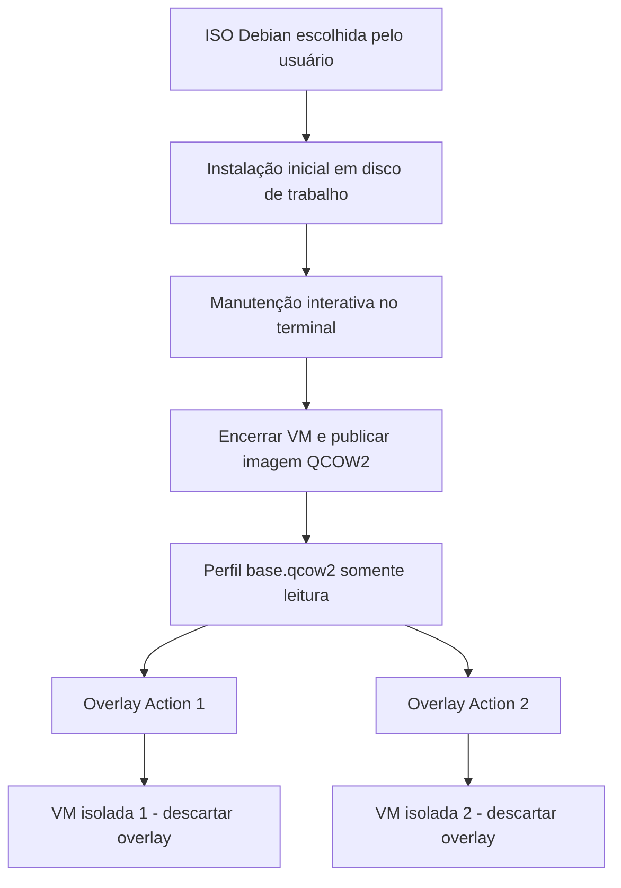

<!-- A-BIOMA-DOC-STANDARD -->
<!-- A-BIOMA-DOC-REVISADO -->

# ARQ-002 — Perfis persistentes e discos descartáveis de VM

**Estado:** perfil por YAML, registro de QCOW2, instâncias descartáveis e Cloud-Init NoCloud automático implementados; instalação do SO pela ISO instaladora ainda pendente.
**Escopo:** armazenamento de perfis Debian, criação a partir de ISO e reutilização em Actions.
**Fluxo de criação:** [FLUX-002](../fluxos/FLUX-002-criacao-perfil-vm.md).
**Fluxo de execução:** [FLUX-001](../fluxos/FLUX-001-execucao-manifesto.md).

## Objetivo

O InsulaVM já consegue **registrar um QCOW2 com sistema previamente instalado** como perfil e executar Actions futuras em instâncias derivadas **descartáveis**. A preparação/instalação desse QCOW2 a partir de uma ISO dentro da própria aplicação ainda não foi implementada. O perfil persistente é uma imagem de disco com o sistema já instalado e configurado; não é a ISO de instalação nem um snapshot de memória RAM.

## Modelo de armazenamento recomendado

Usar imagem **QCOW2 autônoma e imutável** para cada versão de perfil, mais overlays QCOW2 com backing file para as instâncias. Ao criar o overlay, o QEMU registra somente os blocos modificados; a criação do arquivo é leve, sem cópia integral do disco. Cada instância precisa inicializar o convidado normalmente: não há promessa de restaurar RAM ou boot instantâneo.



A implementação não deve escrever sobre `base.qcow2` enquanto houver Actions que dependam dela. Atualizações de perfil devem gerar **nova versão imutável** e trocar a referência ativa somente após validação; overlays antigos devem continuar associados à versão original até encerrarem.

### Estrutura proposta

`storage.root` é definido em [config.yaml](../../config.yaml). Os subdiretórios são configuráveis; o exemplo a seguir também mostra a árvore de staging prevista para instalação por ISO (ainda não implementada):

```text
<data_root>/
├── profiles/
│   └── debian-build/
│       ├── profile.yaml             # identidade, recursos, origem e versão ativa
│       └── versions/
│           └── v001/
│               └── base.qcow2       # imagem configurada imutável
├── staging/
│   └── <creation-id>/
│       ├── install.qcow2            # disco modificável durante instalação
│       └── seed.iso                 # se o provisionamento o exigir
└── runs/
    └── <run-id>/
        ├── overlay.qcow2            # alterações de uma Action
        └── seed.iso                 # gerado automaticamente para VM com Cloud-Init
```

A ISO do usuário pode continuar em caminho local externo informado por ele; salvar no manifesto **referência e checksum**, sem mover/apagar o original. A pasta do perfil usa o nome validado solicitado na criação. Nomes devem rejeitar `..`, separadores de caminho, links simbólicos perigosos e colisões. Imagem e metadados persistem; runtime e staging são temporários.

### Metadados persistentes do perfil

O formato inicial de `profile.yaml` já é lido pelo [módulo profile](../../pkg/profile/profile.go), separado do manifesto de execução `insula.yaml`. Campos atuais: `name`, `os`, `memory_mib`, `vcpus`, `disk_gb`, `version`, `image`, `iso` e os overrides opcionais `ssh`. Evoluções como checksums e publicação de novas versões ainda são propostas.

| Informação | Finalidade |
| --- | --- |
| Identificador e nome do perfil | Resolver uma versão sem ambiguidade e associar a pasta |
| RAM em MiB e vCPUs | Configuração padrão de instâncias derivadas |
| Caminho e checksum da ISO usada | Rastreabilidade da instalação; ISO não é usada para rodar cada Action |
| Tamanho do disco, arquitetura e firmware | Recriar domínio compatível com a instalação |
| Versão ativa, nome e checksum da imagem QCOW2 | Detectar corrupção, imutabilidade e concorrência |
| Modo de boot, rede, conta de administração e método de acesso | Iniciar/gerenciar perfil sem armazenar senha ou chave privada em texto |
| Estado da criação/publicação | Evitar que imagens parciais sejam tratadas como perfis válidos |

O **tamanho do disco virtual** é obrigatório na implementação, mas sua forma de escolha (pergunta ao usuário ou padrão configurável) permanece em decisão.

## Instalação inicial e Cloud-Init

O usuário baixa a ISO Debian no hospedeiro e informa seu **caminho absoluto**. O programa verifica que o arquivo existe, é legível, é uma ISO suportada e que há espaço em disco.

Uma **ISO de instalação Debian** inicializa o instalador, e não necessariamente um sistema com Cloud-Init. A instalação pode ocorrer por console gráfico/serial ou ser automatizada no futuro por **Debian Installer Preseed**. Inserir uma ISO NoCloud `CIDATA` separada só produz configuração Cloud-Init quando o sistema inicializado realmente possui Cloud-Init habilitado; isso **não substitui** as etapas do instalador Debian.

Após instalar no disco virtual, configurar conectividade, usuário operacional e SSH (e opcionalmente Cloud-Init) no sistema instalado. Remover/desabilitar boot pelo CD-ROM de instalação antes do boot para manutenção. A integração do primeiro boot definida em [ARQ-001](ARQ-001-motor-insulavm.md) pode ser reutilizada quando o convidado tiver suporte efetivo a Cloud-Init. Não assumir acesso SSH antes disso.

## Terminal interativo

Durante a instalação, expor console compatível com o instalador selecionado (serial, se disponível, ou console gráfico via VNC/SPICE restrito). Depois de instalado, disponibilizar um **novo terminal SSH interativo**, com PTY, para ajustes do usuário. Encerrar a shell/PTY ou sair da sessão faz a CLI retomar o controle e perguntar se quer salvar.

**Desconexão não é desligamento:** antes de publicar a imagem, solicitar encerramento gracioso do sistema e confirmar VM desligada, evitando capturar filesystem ativo. Se a conexão cair de forma inesperada, informar o incidente e oferecer reconexão em vez de salvar silenciosamente.

## Publicação do perfil

1. O usuário encerra a sessão e escolhe **salvar** ou **descartar**.
2. Em caso de descarte, desligar a VM e remover apenas os recursos temporários, preservando ISO original e perfis anteriores.
3. Em caso de salvamento, confirmar estado íntegro, desligamento completo e disco desbloqueado.
4. Publicar o disco como QCOW2 independente (`base.qcow2`), preferindo reutilizar/renomear o QCOW2 de staging quando já independente e válido; converter somente se necessário. Sincronizar arquivos e publicar metadados de modo atômico para evitar versões incompletas.
5. Proteger a imagem-base contra modificações durante execução normal, registrar versão/checksum e liberar o perfil para Actions.

Para **editar um perfil já salvo**, criar overlay de manutenção, nunca escrever na base ativa; publicar uma nova imagem independente/versionada após o encerramento. Não usar `qemu-img commit` em uma base compartilhada por Actions ativas.

## Inicialização de Actions a partir do perfil

1. Resolver perfil e **versão imutável** referenciada no manifesto (ou versão ativa, caso a política permita).
2. Validar imagem, recursos, compatibilidade e permissões; manter referência da versão durante todo o job.
3. Criar `runs/<run-id>/overlay.qcow2` com backing file explícito `base.qcow2` e formato `qcow2`; gerar identidade de VM, MAC, hostname e credenciais efêmeras específicas da instância.
4. Criar domínio Libvirt com recursos padrão do perfil, rede isolada e disco overlay; **não** montar a ISO de instalação.
5. Inicializar VM e confirmar prontidão/SSH. Para imagem Cloud-Init, providenciar `instance-id` UUIDv7 novo, chaves SSH únicas e metadados NoCloud via seed.iso, conforme [ARQ-006](ARQ-006-identidade-registro-sudo.md); tratar `machine-id`, host keys, leases, tokens e credenciais de forma segura.
6. Executar [FLUX-001](../fluxos/FLUX-001-execucao-manifesto.md): preparar repositório e rodar setup/jobs, logs e resultados.
7. Ao terminar, parar e indefinir domínio, remover overlay, ISO efêmera e dados de execução conforme política. A imagem-base não se altera.

Um overlay **não** garante isolamento de rede ou identidade: cada instância deve ter identificadores próprios, não reutilizar chaves privadas persistidas na imagem-base e não expor os arquivos de outras VMs.

## Congelamento de perfil a partir de VM existente — implementado

Além do registro de um QCOW2 já instalado, o InsulaVM permite **congelar** o disco de uma VM gerenciada em um novo perfil nomeado. O método [`Engine.FreezeVM`](../../insulavm/freeze.go) prepara a identidade do convidado, solicita desligamento normal, consolida o overlay por `qemu-img convert` em QCOW2 autônomo, publica `versions/v001/base.qcow2` e só então remove a VM original. O nome de destino não pode colidir com perfil existente. O disco de origem é preservado se a conversão falhar.

As próximas instâncias usam `vm start -profile <nome>` ou [`StartVMWithOptions`](../../insulavm/start_options.go), que permite ajustar RAM/vCPUs **apenas na instância** sem modificar o `profile.yaml` original. O perfil congelado não é ISO de instalação, nem snapshot da memória da VM.

**Pré-requisitos:** SSH gerenciado, Cloud-Init instalado e `ssh.sudo_mode: passwordless`; o processo limpa cache de Cloud-Init e credenciais SSH, mas **não elimina segredos específicos de aplicativos**. Fluxo e falhas estão em [FLUX-004](../fluxos/FLUX-004-congelar-vm.md); comandos em [INTF-TERM-004](../interfaces/terminal/INTF-TERM-004-gerenciar-vms.md).

## Qualidade, segurança e performance

- Implementar lock/versionamento de perfis na publicação, proteção contra remoção de base referenciada e gerenciamento de órfãos.
- Configurar limite de RAM, vCPU e armazenamento; permitir paralelismo apenas conforme recursos do hospedeiro.
- Manter discos fora de pastas acessíveis ao público e restringir permissão do usuário/processo Libvirt.
- Publicar imagem base somente **desligada**. Evitar copiar VM ligada sem mecanismo consistente de snapshot.
- Execução baseada em QCOW2 COW otimiza criação e armazenamento das instâncias; tempo de boot, I/O e desempenho dependem do host, cache e imagem.

## Questões pendentes

- Schema oficial de configurações globais (`data_root`, espaço, disco padrão, rede, privilégios).
- Limites aceitos de RAM/vCPU, disco padrão e política de nome/atualização de perfis.
- Método padrão de instalação pela ISO: console interativo ou Preseed automatizado.
- Console gráfico/serial no primeiro boot, instalação do SSH e política para primeira chave de host.
- Política para limpar estado de máquinas clonadas sem remover software/configurações do usuário.
- Retenção de versões, garbage collection de overlays e artefatos gerados por Actions.

## Fontes técnicas

- QEMU: https://www.qemu.org/docs/master/tools/qemu-img.html
- QEMU — QCOW2: https://www.qemu.org/docs/master/system/images.html
- Libvirt — backing storage: https://libvirt.org/formatstorage.html
- Debian Installer — Preseed: https://wiki.debian.org/DebianInstaller/Preseed
- Cloud-Init — NoCloud: https://docs.cloud-init.io/en/26.1/reference/datasources/nocloud.html
