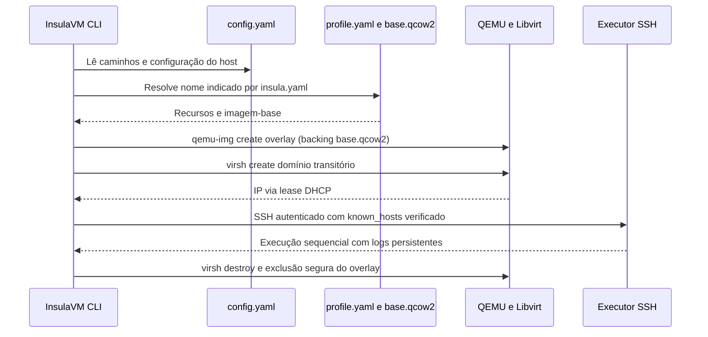

<!-- A-BIOMA-DOC-STANDARD -->
<!-- A-BIOMA-DOC-REVISADO -->

# ARQ-003 — Configuração global e catálogo de perfis de VM

**Estado:** Implementado para arquivos e seleção de perfis, criação de overlay QCOW2 e inicialização Libvirt. **Pendente:** instalação inicial a partir de ISO instaladora e clonagem automática de repositórios Git. Cloud-Init NoCloud automático está implementado em [ARQ-006](ARQ-006-identidade-registro-sudo.md).

**Código fonte:** [config](../../pkg/config/config.go), [profile](../../pkg/profile/profile.go), [runtime](../../pkg/vm/runtime.go), [manifesto](../../pkg/manifest/manifest.go), [CLI](../../main.go).

## Responsabilidades dos três arquivos

| Arquivo | Escopo | Quando é lido |
| --- | --- | --- |
| [`config.yaml`](../../config.yaml) | Caminhos, Libvirt, rede, SQLite, usuário SSH e política sudo | CLI e biblioteca Go |
| `data/profiles/<nome>/profile.yaml` | Nome, OS, RAM (MiB), vCPUs, disco, versão, caminho QCOW2 e eventuais overrides SSH | Consulta, registro e execução do perfil |
| [`insula.yaml`](../../insula.yaml.example) | Perfil escolhido, origem identificadora do projeto, workspace, setup e pipelines/jobs | Execução da Action |

O perfil **não** contém a instalação do sistema por si só: `profile.yaml` aponta para um arquivo binário `base.qcow2` com o sistema operacional já instalado. Os segredos não devem constar dos YAMLs.

## Pastas criadas pela aplicação

```text
<data_root>/
├── profiles/
│   └── debian-minimal/
│       ├── profile.yaml
│       └── versions/
│           └── v001/
│               └── base.qcow2
├── runs/
│   └── insula-vm-XXXXXX/
│       ├── overlay.qcow2
│       └── domain.xml
└── logs/
    └── <repositorio>/<action>/<YYYYMMDD_HHMMSS>/<job>.log
```

Os nomes das pastas internas são configuráveis em `storage`. O parâmetro `storage.root` relativo é interpretado a partir do diretório do próprio `config.yaml`; `profiles`, `runs` e `logs` relativos são interpretados a partir de `storage.root`. Arquivos temporários são descartados ao final da execução se o domínio Libvirt for comprovadamente encerrado; os logs e perfis persistem.

## Inicialização a partir de perfil



**Modo externo:** quando `-host` ou `profile.ssh.address` está definido, a CLI acessa essa VM já existente **sem** criar uma nova máquina. Isso permite testar apenas o executor SSH enquanto a base de VM está sendo preparada.

## Registro de uma imagem já preparada

O comando `profile register` recebe uma **imagem QCOW2 com SO já instalado**, verifica a assinatura inicial do formato, copia para uma versão `v001` e grava metadados YAML. O mesmo nome não pode ser registrado duas vezes. Registro e execução têm campos limitados aos implementados; não há criação de ISO nem instalação de Debian/Arch neste comando.

Exemplo:

```bash
go run . profile register -config config.yaml \
  -name debian-minimal -image /tmp/debian-installed.qcow2 \
  -memory-mib 1024 -vcpus 1 -disk-gb 8 -os debian
go run . profile list -config config.yaml
go run . profile show -config config.yaml -name debian-minimal
```

## Prerrequisitos e segurança

- Um host Linux com KVM/QEMU, `qemu-img` e `virsh`, acesso a `qemu:///system` (ou URI configurada) e uma rede Libvirt ativa com DHCP.
- A imagem-base deve ter Linux instalado, Cloud-Init e SSH pré-instalados, boot VirtIO e DHCP ativos; o InsulaVM gera chaves SSH individuais e uma ISO NoCloud por VM. Não ocorre login por senha ou desativação da verificação da host key.
- O usuário/daemon Libvirt precisa de permissões apropriadas para atravessar as pastas e abrir o QCOW2. A aplicação cria pastas privadas; configure ACLs/grupos explicitamente, **não** libere leitura ou escrita irrestrita em imagens.
- O InsulaVM cria a identidade SSH de cada convidado, injeta no Cloud-Init e gera o `known_hosts` correspondente antes da autenticação. A imagem-base precisa ter o cache Cloud-Init limpo antes do registro e ser adequada à clonagem.
- Apenas discos QCOW2 são suportados; imagens de instalação ISO não são diretamente executáveis como perfil pronto.
- A rotina de runtime não cria o repositório nem o `workspace`: ambos devem existir dentro da VM antes da Action.
- Para segurança, erros de destruição que não permitam confirmar a parada da VM bloqueiam remoção do overlay.

## Pendências

1. Instalar SO a partir da ISO local com console/terminal, validar a instalação e publicar um novo perfil, conforme [FLUX-002](../fluxos/FLUX-002-criacao-perfil-vm.md).
2. Validar Cloud-Init NoCloud e a autenticação automática em uma VM KVM real; a implementação e os testes simulados estão em [ARQ-006](ARQ-006-identidade-registro-sudo.md).
3. Transferência do repositório e criação automática do workspace antes dos jobs.
4. Versionamento de perfis além de `v001`, locks de publicação, autenticação de operações de manutenção e política de retenção de logs.

## Fontes técnicas

- [QEMU qemu-img](https://www.qemu.org/docs/master/tools/qemu-img.html)
- [Libvirt virsh](https://www.libvirt.org/manpages/virsh.html)
