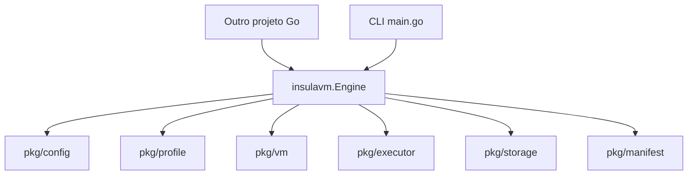

<!-- A-BIOMA-DOC-STANDARD -->
<!-- A-BIOMA-DOC-REVISADO -->

# ARQ-004 — Biblioteca Go para orquestração integrada

**Estado:** pacote público implementado e testado; interface experimental, ainda sem versão pública estável.
**Código canônico:** [insulavm/engine.go](../../insulavm/engine.go).
**Exemplo compilável:** [examples/go-library/main.go](../../examples/go-library/main.go).
**CLI:** [main.go](../../main.go), que agora utiliza o mesmo motor da biblioteca.

## Objetivo

Permitir que outro módulo Go controle o InsulaVM **diretamente em processo**, sem `os/exec`, sockets UDS, HTTP ou um processo daemon. CLI e bibliotecas utilizam o mesmo mecanismo de configuração, perfil, VM, SSH e logs. Os arquivos `config.yaml`, `profile.yaml` e `insula.yaml` continuam disponíveis, mas o manifesto pode ser construído diretamente em memória no consumidor.

## Módulo e importação

O `go.mod` existente declara o módulo:

```text
github.com/ahhvahh/InsulaVM
```

A raiz do repositório ainda contém a CLI como `package main`; uma aplicação **não pode importar `package main` como biblioteca**. A nova API pública encontra-se em pacote próprio:

```go
import "github.com/ahhvahh/InsulaVM/insulavm"
```

Em outro módulo Go, adicionar a dependência com:

```bash
go get github.com/ahhvahh/InsulaVM/insulavm@main
go mod tidy
```

Usar `@main` traz a revisão da branch na resolução inicial; a versão efetiva é fixada no `go.mod` do consumidor. Para integração reprodutível e evolução sem surpresas, **publicar tags semânticas `v0.x.y`** após estabilizar o contrato. Nenhuma tag de versão é declarada criada nesta etapa. Não usar `replace` permanente como mecanismo de publicação; `replace` serve somente para desenvolvimento local.

## API pública atual

| Operação | Assinatura | Responsabilidade |
| --- | --- | --- |
| Criar motor | `insulavm.New(configPath)` | Valida e lê o arquivo global, sem iniciar VM |
| Configuração | `Engine.Configuration()` | Cópia dos parâmetros globais |
| Listar perfis | `Engine.ListProfiles()` | Nomes dos perfis válidos |
| Obter perfil | `Engine.GetProfile(name)` | Metadados de configuração sem executar VM |
| Registrar perfil | `Engine.RegisterProfile(profile, sourceQCOW2)` | Cópia imagem QCOW2 existente, sem instalar SO |
| Iniciar VM | `Engine.StartVM(ctx, profileName)` | Cria overlay, inicia VM e retorna instância para cleanup explícito |
| Executar Action | `Engine.Run(ctx, RunRequest)` | Perfil/host, imports locais, SSH, setup, jobs, logs e cleanup |
| Importar arquivos | `Engine.ImportPath(ctx, ImportRequest)` | Compactar arquivo/pasta, enviar SSH, extrair na VM e acompanhar o progresso |
| Gerenciar VMs | `Engine.StartVM/GetVM/ListVMs/StopVM` | SQLite UUIDv7, MAC, IP e credenciais SSH da instância |
| Executar por ID | `Engine.ExecVM(ctx, ExecRequest)` | Comando como usuário comum ou elevação explícita por `sudo -n` |

O `RunRequest` também oferece `OnImportProgress func(ImportProgress)` para informar estágios de transferência. O resultado `RunResult.Imports` contém as importações concluídas. Mais detalhes em [ARQ-005](ARQ-005-importacao-arquivos.md).

O `RunRequest` oferece `ManifestPath` **ou** `Manifest *insulavm.Manifest` (exclusivos), `Host`, `User`, `PrivateKey`, `KnownHosts`, `LogRoot`, `CommandTimeout` e `Output io.Writer`.

O `RunResult` retorna `Profile`, `Host`, `VMName`, `LogDirectory`, `CompletedJobs`, `StartedAt` e `FinishedAt`. Em caso de erro depois de iniciar a execução, `Run` devolve, quando disponível, **resultado parcial e erro**. O erro de cleanup não substitui o original.

`Run` é **bloqueante** até a conclusão dos jobs. O orquestrador pode chamá-lo em goroutine se desejar concorrência e controlar cancelamento/timeouts com `context.Context`. Não há fila, banco de estados ou `GetStatus` dentro da biblioteca neste ciclo. Para streaming, o consumidor fornece um `io.Writer`; o motor continua salvando os logs físicos. O consumidor deve sincronizar um writer compartilhado por execuções concorrentes.

## Exemplo: outro projeto Go

```go
engine, err := insulavm.New("/etc/insulavm/config.yaml")
if err != nil { return err }

manifest := &insulavm.Manifest{
    Repository: insulavm.Repository{Name: "meu-projeto"},
    Action: "build",
    Workspace: "/app/repo-workspace",
    Pipelines: []insulavm.Pipeline{
        {Name: "build", Jobs: []insulavm.Job{
            {Name: "compilar", Commands: []string{"go build ./..."}},
        }},
    },
}
result, err := engine.Run(ctx, insulavm.RunRequest{
    Manifest: manifest,
    Host: "192.0.2.10:22", // Máquina já inicializada
    User: "insula",
    PrivateKey: "/etc/insulavm/id_ed25519",
    KnownHosts: "/etc/insulavm/known_hosts",
    Output: os.Stdout,
})
if result != nil {
    fmt.Println("Logs:", result.LogDirectory)
}
return err
```

Os valores de IP/chaves são ilustrativos. Para criar uma VM descartável a partir do perfil, o manifesto deve indicar `Profile: "nome"` e não receber Host existente.

## Arquitetura interna



O pacote `insulavm` é o ponto de entrada recomendado. Os pacotes em `pkg/` continuam acessíveis, mas não devem ser tratados como uma superfície pública estável até o versionamento e a revisão de compatibilidade.

## Limites atuais e condições de operação

- **Não implementado:** instalar SO da ISO instaladora, clonar automaticamente um repositório Git, expor API REST/UDS e fila gerenciada. Bootstrap Cloud-Init NoCloud, SQLite e sudo são implementados em [ARQ-006](ARQ-006-identidade-registro-sudo.md). O upload de arquivos e diretórios locais já foi implementado pelo método `ImportPath` e pelo `imports` do manifesto.
- **Necessário para VM automática:** perfil QCOW2 com SO já instalado, Cloud-Init/SSH/sudo preparado, suporte VirtIO/DHCP, hipervisor KVM/QEMU/Libvirt e permissões de armazenamento adequadas.
- **Necessário para modo Host:** máquina Linux já acessível por SSH e diretório de trabalho presente.
- **Segurança:** scripts do manifesto executam shell; acesso a Libvirt concede privilégios relevantes. O chamador deve validar permissões, não usar manifestos de origem não confiável, não inserir segredos em comandos/logs e configurar chaves/host keys verificadas.
- **Concorrência:** instâncias e arquivos de log são independentes, mas ainda faltam limites globais, lock/versionamento de perfis e teste de carga real em KVM.
- **Versionamento:** API experimental. Mudanças que alterem comportamento/assinaturas exigem planejamento e testes de compatibilidade antes da primeira versão estável.

## Fontes técnicas

- Módulos: https://go.dev/doc/modules/developing
- Layout de módulos: https://go.dev/doc/modules/layout
- Uso de `context.Context`: https://pkg.go.dev/context
