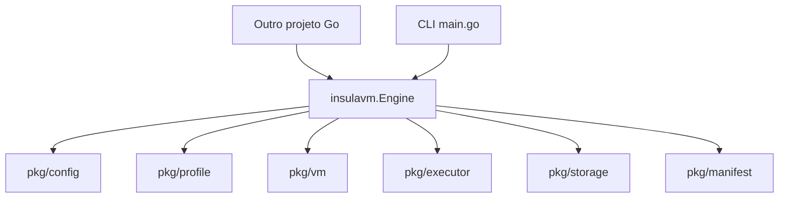

<!-- A-BIOMA-DOC-STANDARD -->
<!-- A-BIOMA-DOC-REVISADO -->

# ARQ-004 — Biblioteca Go para orquestração integrada

**Estado:** pacote público implementado e testado; interface experimental, ainda sem versão pública estável.
**Código canônico:** [insulavm/engine.go](../../insulavm/engine.go).
**Exemplo compilável:** [examples/go-library/main.go](../../examples/go-library/main.go).
**CLI:** [main.go](../../main.go), que agora utiliza o mesmo motor da biblioteca.

## Objetivo

Permitir que outro módulo Go controle o InsulaVM **diretamente em processo**, sem `os/exec`, sockets UDS, HTTP ou um processo daemon. CLI e bibliotecas utilizam o mesmo mecanismo de configuração, perfil, VM, SSH e logs. Os arquivos `config.yaml`, `profile.yaml` e `insula.yaml` continuam disponíveis, mas o manifesto pode ser construído diretamente em memória no consumidor.

## Módulo e importação

O `go.mod` existente declara o módulo:

```text
github.com/ahhvahh/InsulaVM
```

A raiz do repositório ainda contém a CLI como `package main`; uma aplicação **não pode importar `package main` como biblioteca**. A nova API pública encontra-se em pacote próprio:

```go
import "github.com/ahhvahh/InsulaVM/insulavm"
```

Em outro módulo Go, adicionar a dependência com:

```bash
go get github.com/ahhvahh/InsulaVM/insulavm@main
go mod tidy
```

Usar `@main` traz a revisão da branch na resolução inicial; a versão efetiva é fixada no `go.mod` do consumidor. Para integração reprodutível e evolução sem surpresas, **publicar tags semânticas `v0.x.y`** após estabilizar o contrato. Nenhuma tag de versão é declarada criada nesta etapa. Não usar `replace` permanente como mecanismo de publicação; `replace` serve somente para desenvolvimento local.

## API pública atual

| Operação | Assinatura | Responsabilidade |
| --- | --- | --- |
| Criar motor | `insulavm.New(configPath)` | Valida e lê o arquivo global, sem iniciar VM |
| Configuração | `Engine.Configuration()` | Cópia dos parâmetros globais |
| Listar perfis | `Engine.ListProfiles()` | Nomes dos perfis válidos |
| Obter perfil | `Engine.GetProfile(name)` | Metadados de configuração sem executar VM |
| Registrar perfil | `Engine.RegisterProfile(profile, sourceQCOW2)` | Cópia imagem QCOW2 existente, sem instalar SO |
| Iniciar VM | `Engine.StartVM(ctx, profileName)` / `StartVMWithProgress` | Inicia instância do perfil e informa progresso opcional; encerramento explícito |
| Iniciar com recursos específicos | `Engine.StartVMWithOptions(ctx, VMStartOptions, callback)` | Reutiliza um perfil com RAM/vCPUs por instância, política opcional de limpeza no cancelamento |
| Executar Action | `Engine.Run(ctx, RunRequest)` | Perfil/host, imports locais, SSH, setup, jobs, logs e cleanup |
| Importar arquivos | `Engine.ImportPath(ctx, ImportRequest)` | Compactar arquivo/pasta, enviar SSH, extrair na VM e acompanhar o progresso |
| Importar por UUID | `Engine.ImportToVM(ctx, VMImportRequest)` | Resolve automaticamente IP, porta e credenciais SSH do registro SQLite |
| Gerenciar VMs | `Engine.GetVM/ListVMs/GetVMStatus/ListVMStatus/StopVM` | SQLite UUIDv7 + estado real no Libvirt; encerra por ID |
| Encerrar em lote | `Engine.StopAllVMs(ctx, VMStopAllOptions)` | Trata somente VMs registradas, com `DryRun`, retorno parcial e erros agregados |
| Deploy de arquivo+script | `Engine.DeployToVM(ctx, VMDeployRequest)` | Transfere arquivo e script, extrai opcionalmente, executa Bash e devolve progresso parcial |
| Congelar VM preparada | `Engine.FreezeVM(ctx, VMFreezeRequest)` | Publica um novo perfil QCOW2 autônomo com nome exclusivo, após desligar VM de origem |
| Executar por ID | `Engine.ExecVM(ctx, ExecRequest)` | Comando como usuário comum ou elevação explícita por `sudo -n` |

O `RunRequest` também oferece `OnImportProgress func(ImportProgress)` para informar estágios de transferência. O resultado `RunResult.Imports` contém as importações concluídas. Mais detalhes em [ARQ-005](ARQ-005-importacao-arquivos.md).

O `RunRequest` oferece `ManifestPath` **ou** `Manifest *insulavm.Manifest` (exclusivos), `LogRoot`, `CommandTimeout`, `Output io.Writer` e callbacks. Os campos `Host`, `User`, `PrivateKey` e `KnownHosts` são opcionais para conectar a **hosts externos**; não são necessários ao criar VMs gerenciadas por perfil, pois SSH é provisionado automaticamente.

O `RunResult` retorna `SSHUser`, `Profile`, `Host`, `VMID`, `VMName`, `LogDirectory`, `CompletedJobs`, `StartedAt` e `FinishedAt`. Em caso de erro depois de iniciar a execução, `Run` devolve, quando disponível, **resultado parcial e erro**. O erro de cleanup não substitui o original.

`Run` é **bloqueante** até a conclusão dos jobs. O orquestrador pode chamá-lo em goroutine se desejar concorrência e controlar cancelamento/timeouts com `context.Context`. Há registro SQLite de estados das VMs e consulta por `GetVMStatus`/`ListVMStatus`. Não há fila gerenciada nem API para acompanhar o progresso de cada job após o retorno de `Run`. Para streaming, o consumidor fornece um `io.Writer`; o motor continua salvando os logs físicos. O consumidor deve sincronizar um writer compartilhado por execuções concorrentes.

## Contratos de ciclo de vida acrescentados

### `StartVMWithOptions`

`VMStartOptions` contém `Profile` (nome registrado), `MemoryMiB` e `VCPUs` (zero mantém o padrão do perfil), `StopOnContextDone` e `OnStopError`. A função devolve `*vm.Instance` (inclui `ID`, `Name`, `IPAddress`, credenciais SSH) e `error`. Sem `StopOnContextDone`, a VM permanece ativa até `StopVM`/`Cleanup`. Quando habilitada, a limpeza ao cancelar o contexto é **assíncrona e de melhor esforço**; use `StopVM` para aguardar a operação e observar erros.

### `StopAllVMs`

`VMStopAllOptions` aceita `DryRun` e `OnProgress`; `VMStopAllResult` oferece `Checked`, `Targets`, `Stopped`, `Skipped` e `Failed`. Em falhas pontuais retorna um resultado parcial e erro agregado. A implementação consulta somente instâncias cadastradas no SQLite deste motor e confere o Libvirt; não encerra domínios externos. Veja [PERS-001](../persistencia/PERS-001-registro-instancias.md).

### `DeployToVM`

`VMDeployRequest` contém `VMID`, `SourcePath`, `ScriptPath`, `Extract`, `Sudo`, `Output` e `CommandTimeout`. `VMDeployResult` registra as etapas de importação e execução, arquivo, script, destino e caminho de logs. `error == nil` indica sucesso completo; em falha, etapas concluídas podem permanecer no resultado. Veja [FLUX-005](../fluxos/FLUX-005-deploy-arquivos.md).

### `FreezeVM`

`VMFreezeRequest` contém `VMID`, `Name`, `ShutdownTimeout` e `OnProgress`. `VMFreezeResult` devolve `VMID`, `ProfileName`, `ImagePath`, `SourceStopped` e `SourceCleaned`; é possível receber resultado **parcial e erro**, inclusive após a imagem já ter sido publicada. O processo exige sudo sem senha e gera **QCOW2**, não ISO. Veja [FLUX-004](../fluxos/FLUX-004-congelar-vm.md).

As operações acima são síncronas, exceto a política `StopOnContextDone` que dispara cleanup em goroutine. API ainda experimental e sem contrato de compatibilidade estável.

## Exemplo: outro projeto Go

```go
engine, err := insulavm.New("/etc/insulavm/config.yaml")
if err != nil { return err }

manifest := &insulavm.Manifest{
    Profile: "debian-minimal",
    Repository: insulavm.Repository{Name: "meu-projeto"},
    Action: "build",
    // Opcional; omitido: utiliza ssh.user global (padrão insula).
    // SSH: insulavm.SSHOptions{User: "buildagent"},
    Imports: []insulavm.ImportSpec{
        {Source: "/srv/meu-projeto"},
        {Source: "/srv/extra.ini"},
    },
    Pipelines: []insulavm.Pipeline{{
        Name: "build",
        Jobs: []insulavm.Job{{
            Name: "compilar",
            Commands: []string{"go build ./..."},
        }},
    }},
}
result, err := engine.Run(ctx, insulavm.RunRequest{
    Manifest: manifest,
    Output: os.Stdout,
})
if result != nil { fmt.Println("Logs:", result.LogDirectory) }
return err
```

O destino físico **dentro do convidado** é sempre o `guest.destination` global do `config.yaml`, compartilhado entre todas as importações e utilizado por padrão para os jobs. O método `Engine.ImportToVM` recebe apenas `VMID` e `SourcePath`, recuperando IP, chave e usuário do SQLite. O manifesto não contém `destination`, senha ou chave SSH.

A biblioteca permite executar `Engine.Run` com `SSH.User` por Action ou, se omitido, o usuário global `insula`. Para perfil gerenciado, o Cloud-Init cria o usuário escolhido e configura as credenciais específicas da instância. Consulte [ARQ-005](ARQ-005-importacao-arquivos.md).

## Arquitetura interna



O pacote `insulavm` é o ponto de entrada recomendado. Os pacotes em `pkg/` continuam acessíveis, mas não devem ser tratados como uma superfície pública estável até o versionamento e a revisão de compatibilidade.

## Limites atuais e condições de operação

- **Não implementado:** instalar SO da ISO instaladora, clonar automaticamente um repositório Git, expor API REST/UDS e fila gerenciada. Bootstrap Cloud-Init NoCloud, SQLite e sudo são implementados em [ARQ-006](ARQ-006-identidade-registro-sudo.md). O upload de arquivos e diretórios locais já foi implementado pelo método `ImportPath` e pelo `imports` do manifesto.
- **Necessário para VM automática:** perfil QCOW2 com SO já instalado, Cloud-Init/SSH/sudo preparado, suporte VirtIO/DHCP, hipervisor KVM/QEMU/Libvirt e permissões de armazenamento adequadas.
- **Necessário para modo Host:** máquina Linux já acessível por SSH e diretório de trabalho presente.
- **Segurança:** scripts do manifesto executam shell; acesso a Libvirt concede privilégios relevantes. O chamador deve validar permissões, não usar manifestos de origem não confiável, não inserir segredos em comandos/logs e configurar chaves/host keys verificadas.
- **Concorrência:** instâncias e arquivos de log são independentes, mas ainda faltam limites globais, lock/versionamento de perfis e teste de carga real em KVM.
- **Versionamento:** API experimental. Mudanças que alterem comportamento/assinaturas exigem planejamento e testes de compatibilidade antes da primeira versão estável.

## Fontes técnicas

- Módulos: https://go.dev/doc/modules/developing
- Layout de módulos: https://go.dev/doc/modules/layout
- Uso de `context.Context`: https://pkg.go.dev/context
