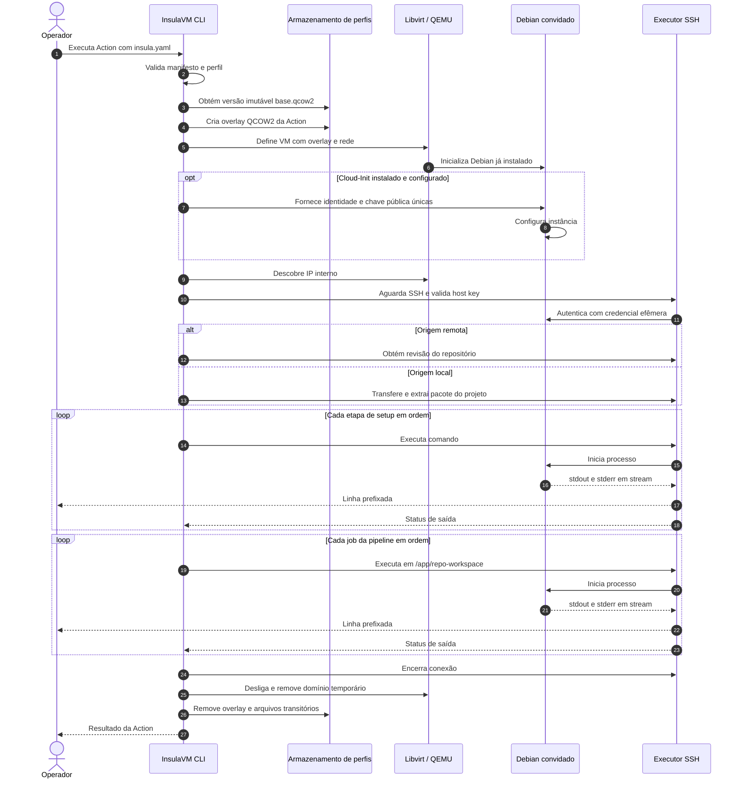

<!-- A-BIOMA-DOC-STANDARD -->
<!-- A-BIOMA-DOC-REVISADO -->

# FLUX-001 — Execução de Action com manifesto `insula.yaml`

**Estado:** seleção de perfil, overlay QCOW2, início de VM via Libvirt, importação TAR.GZ opcional, SSH e logs implementados; Cloud-Init, checkout de repositório Git e instalação de SO ainda propostos. Ver [FLUX-003](FLUX-003-execucao-sequencial-logs.md) e [ARQ-003](../arquitetura/ARQ-003-configuracao-perfis.md).
**Versão aprovada:** nenhuma.
**Ponto de entrada:** futura CLI com `insula.yaml` referenciando perfil de VM publicado.
**Arquitetura do motor:** [ARQ-001](../arquitetura/ARQ-001-motor-insulavm.md).
**Perfis e overlays:** [ARQ-002](../arquitetura/ARQ-002-perfis-vm.md).
**Criação de perfil:** [FLUX-002](FLUX-002-criacao-perfil-vm.md).

## Limite atual da implementação

O [FLUX-003](FLUX-003-execucao-sequencial-logs.md) implementa a execução sequencial SSH e os logs, e o [módulo de runtime](../../pkg/vm/runtime.go) já cria overlays QCOW2, inicia domínios Libvirt transitórios e tenta removê-los ao final. Uma imagem QCOW2 **previamente instalada**, com DHCP e SSH, deve estar registrada. Cloud-Init por instância, checkout automático do projeto a partir de Git e instalação inicial por ISO continuam pendentes. A importação de arquivos e diretórios do hospedeiro para a VM, antes dos jobs, está implementada em [ARQ-005](../arquitetura/ARQ-005-importacao-arquivos.md).

## Objetivo

Executar `setup` e pipelines/jobs em instância descartável derivada de um **perfil Debian previamente instalado e salvo**, com logs enviados continuamente ao hospedeiro. Conservar a imagem-base, remover o disco de escrita da Action ao final e apresentar sucesso, erro ou cancelamento.

## Pré-condições

- Manifesto YAML legível que seleciona perfil e, conceitualmente, origem local/remota do projeto, `setup` e jobs. **Nomes e tipos finais do YAML ainda não foram definidos**.
- Perfil publicado e validado conforme [FLUX-002](FLUX-002-criacao-perfil-vm.md), com versão de imagem QCOW2 imutável.
- Capacidade do host KVM/QEMU/Libvirt, permissões de rede e disco para overlay; recursos conforme perfil.
- O perfil precisa oferecer **bootstrap remoto confiável** (preferencialmente Cloud-Init instalado e preparado no sistema convidado) para identidade, rede e autenticação SSH. Apenas ter sido instalado pela ISO Debian não garante isso.
- Nenhuma execução anterior deve ter modificado a imagem-base; cada Action recebe overlay novo.

## Sequência de execução



O diagrama acima representa **sucesso**. Em caso de erro, timeout ou cancelamento, os jobs seguintes não executam por padrão e o controle salta para a finalização.

## Etapas

1. **Validar manifesto:** confirmar campos, referência do perfil, origem do projeto e jobs; rejeitar entradas inválidas antes de criar VM.
2. **Resolver perfil:** localizar `profile.yaml`, imagem da versão selecionada, recursos de RAM e CPU; impedir remoção da versão em uso.
3. **Criar disco de trabalho:** reservar `runs/<run-id>/` e criar overlay QCOW2 com backing file e formato explícitos, sem copiar completamente a imagem-base. Gerar nome da instância, MAC e identificadores próprios.
4. **Provisionar instância:** preparar eventuais metadados Cloud-Init NoCloud para o convidado que efetivamente tenha Cloud-Init habilitado, com `instance-id` e credenciais efêmeras. Limpar identidades clonadas com método seguro conforme [ARQ-002](../arquitetura/ARQ-002-perfis-vm.md). Criar domínio Libvirt usando o disco overlay e iniciar pelo sistema já instalado, **sem boot pela ISO de instalação**.
5. **Aguardar prontidão:** descobrir IP interno, validar host key SSH usando fonte confiável, conectar e aguardar a conclusão do bootstrap necessário com limite de tempo.
6. **Obter repositório:** clonar revisão remota especificada ou receber projeto local por canal autenticado e preparar a pasta de trabalho proposta `/app/repo-workspace`. Repositórios privados não devem expor tokens em logs, ISO ou arquivos da VM.
7. **Executar `setup`:** executar comandos sequenciais antes dos jobs; permissões, contexto do diretório e privilégios são decisões a registrar no futuro contrato.
8. **Executar pipelines:** uma sessão SSH por comando/job, com diretório contextualizado como `cd /app/repo-workspace && <comando>`; usar `StdoutPipe()` e `StderrPipe()` antes de `Start()`, leitores concorrentes com buffer ajustável, streaming de linhas prefixadas (`[run-tests]`) enquanto processo executa e `Wait()` para obter retorno. Proteger concatenação do caminho.
9. **Consolidar resultado:** informar etapa/job, status do processo e causa da falha. Conteúdo em stderr isoladamente não caracteriza falha; não há ordem total garantida entre stdout e stderr.
10. **Finalizar sempre:** fechar sessões/SSH, encerrar VM, remover domínio, disco overlay e ISO de bootstrap temporária; **nunca apagar nem alterar a imagem-base ou os metadados do perfil**. Reportar falhas de limpeza sem suprimir o erro principal.

## Resultados observáveis

| Evento | Saída planejada |
| --- | --- |
| Início de uma etapa/job | Identificador e início da execução |
| Linha em stdout | Linha emitida imediatamente com prefixo do job |
| Linha em stderr | Linha emitida imediatamente com prefixo e identificação da origem no coletor |
| Fim do comando | Código de retorno e status de sucesso/falha |
| Erro ou cancelamento | Motivo, último job/etapa e início da limpeza |
| Encerramento da Action | Resultado consolidado, incluindo eventual erro secundário de limpeza |

Exemplo **apenas ilustrativo**:

```text
[setup] Atualizando índices de pacotes...
[run-tests] Iniciando testes...
[run-tests] 25 testes executados.
```

Métodos como `Output()` e `CombinedOutput()` não cumprem o requisito de streaming durante a execução. Os leitores de stdout/stderr devem drenar os pipes de forma concorrente antes de `Wait()`, com limite de tamanho/tempo e política de cancelamento.

## Falhas e exceções

| Situação | Ação planejada |
| --- | --- |
| YAML inválido ou perfil inexistente | Rejeitar sem subir VM |
| Perfil corrompido/versão indisponível ou host sem recursos | Bloquear provisionamento |
| Falha ao criar overlay ou domínio | Remover recursos parciais, preservar perfil |
| Sem método seguro de bootstrap/SSH | Falhar antes de executar scripts |
| Erro de Cloud-Init, IP ou host key | Bloquear jobs e encerrar instância |
| Falha de clone ou transferência | Não executar `setup` nem pipeline |
| `setup` retorna código não zero | Interromper jobs dependentes |
| Job falha | Por padrão, interromper os próximos jobs |
| Timeout, saída extensa ou cancelamento | Interromper trabalho remoto, drenar ou encerrar leitores e limpar |
| Falha na limpeza | Registrar erro secundário, sem alterar perfil original |

## Critérios de aceite futuro

- Instância é iniciada de perfil previamente salvo, sem iniciar instalador Debian.
- A imagem-base não recebe escritas; múltiplas Actions podem trabalhar com overlays independentes segundo limites de recursos do hospedeiro.
- Jobs executam na raiz do projeto, em ordem, e publicam logs antes de terminar o comando.
- Erro, interrupção ou cancelamento remove os dados temporários, sem remover o perfil.
- Testes devem cobrir origem local/remota, setup e job com falha, stdout/stderr, timeout, SSH indisponível, cancelamento, concorrência e cleanup.

## Pendências

O schema oficial de `insula.yaml`, seleção/versão de perfil, nome e flags da CLI, códigos de saída e política de paralelismo ainda dependem de contrato. Também é necessário validar provisionamento de identidades únicas em perfis clonados, rede, host keys e políticas para retenção de artefatos.
