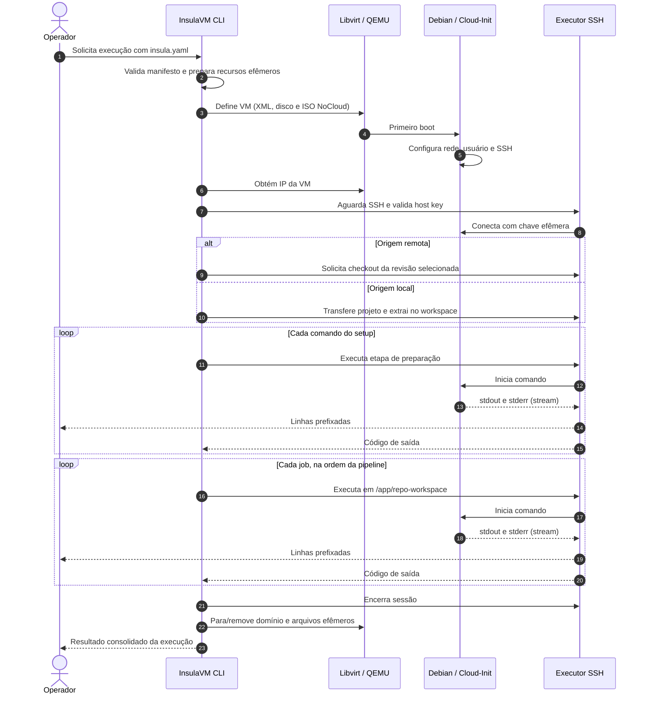

<!-- A-BIOMA-DOC-STANDARD -->
<!-- A-BIOMA-DOC-REVISADO -->

# FLUX-001 — Execução de manifesto `insula.yaml`

**Estado:** Proposto — não implementado.
**Versão aprovada:** nenhuma.
**Ponto de entrada:** invocação da futura CLI InsulaVM com um arquivo `insula.yaml`.
**Detalhes de componentes:** [ARQ-001 — Arquitetura do motor](../arquitetura/ARQ-001-motor-insulavm.md).

## Objetivo

Executar etapas de preparação do Debian e pipelines sequenciais sobre uma cópia de um projeto, em VM isolada, com logs exibidos em tempo real no terminal hospedeiro. Cada execução deve finalizar com resultado explícito e limpeza de recursos efêmeros.

## Entrada e pré-condições

- Um manifesto YAML legível, contendo conceitualmente a origem do projeto (local ou remota), configuração da VM, comandos de `setup` e sequência de pipelines/jobs. **Os nomes e tipos finais dos campos ainda não são contrato aprovado.**
- Hospedeiro Linux com capacidade KVM/QEMU/Libvirt e imagem Debian preparada para Cloud-Init.
- Permissões para provisionar VM e rede; armazenamento suficiente; conectividade para obter origem remota quando necessário.
- A VM deve ser provisionada a partir de uma imagem limpa, não reaproveitando alterações da execução anterior.

## Diagrama de sequência



**Nota:** o diagrama mostra o caminho de sucesso. Falhas e cancelamentos saltam para a fase de finalização e limpeza, conforme abaixo.

## Passos do fluxo

1. **Ler e validar:** analisar YAML, exigir origem compatível e verificar condições de VM e jobs. Rejeitar parâmetros inválidos antes de criar recursos.
2. **Preparar execução:** identificar a execução; reservar diretório temporário; obter imagem-base; criar disco de trabalho limpo; gerar par de chaves SSH e ISO NoCloud contendo `user-data`, `meta-data` e opcional `network-config`.
3. **Provisionar e iniciar:** gerar XML de domínio Libvirt, anexar disco e ISO como CD-ROM, conectar rede e iniciar VM Debian.
4. **Aguardar prontidão:** descobrir IP interno, confirmar rede, SSH e conclusão da preparação necessária do Cloud-Init; aplicar tentativas e tempo limite.
5. **Materializar projeto:** para origem remota, clonar/baixar revisão especificada; para origem local, transferir pacote do hospedeiro e extrair. Preparar diretório-base proposto `/app/repo-workspace`. Confirmar que há conteúdo acessível.
6. **Executar `setup`:** processar comandos em ordem, antes de qualquer pipeline; cada comando retorna um status e emite stdout/stderr em fluxo. Permissões e diretório do setup serão definidos no contrato do manifesto.
7. **Executar pipelines:** para cada job em ordem declarada, iniciar sessão SSH própria, aplicar diretório de trabalho na raiz do projeto (`cd /app/repo-workspace && <comando>`), ler stdout/stderr concorrentemente e aguardar status de término. Um job dependente só inicia após êxito do anterior, salvo política futura explícita.
8. **Informar resultado:** exibir conclusão, job/etapa de falha, código de saída conhecido e resumo. Uma linha de log não equivale ao resultado do processo.
9. **Finalizar sempre:** cancelar/fechar comandos e conexões ainda abertos, tentar encerramento gracioso da VM e, se necessário, destruição; remover domínio, discos efêmeros, ISO e chaves temporárias. Falhas na limpeza devem aparecer no resumo, sem ocultar a falha original.

## Eventos e saída observável

| Evento | Resultado observável proposto |
| --- | --- |
| Início de etapa/job | Identificador da etapa e execução em andamento |
| Linha em stdout | Linha publicada imediatamente, com prefixo do job |
| Linha em stderr | Linha publicada imediatamente, com prefixo do job e origem stderr distinguível no coletor |
| Término de comando | Código/status de execução, independente de mensagens stderr |
| Falha/cancelamento | Interromper jobs dependentes, registrar motivo e iniciar limpeza |
| Término da execução | Resultado final e eventual falha de limpeza |

Exemplo **ilustrativo**, não validado por implementação:

```text
[setup] Atualizando índices de pacotes...
[run-tests] Iniciando testes...
[run-tests] 25 testes executados.
```

Para streaming, a futura implementação deverá configurar `StdoutPipe()` e `StderrPipe()` antes de `Start()`, drenar ambos em paralelo com `Scanner` (buffer ajustável para linhas longas), publicar linhas enquanto o processo roda e consultar `Wait()` ao fim. `Output()` e `CombinedOutput()` não atendem ao requisito de streaming contínuo. A ordem relativa entre stdout e stderr não é garantida.

## Exceções e tratamento

| Situação | Comportamento planejado |
| --- | --- |
| YAML inválido ou origem inacessível | Falhar com motivo claro; não iniciar jobs |
| Host sem KVM/Libvirt ou imagem inválida | Abortar provisionamento e remover recursos já criados |
| Falha Cloud-Init/IP/SSH/host key | Não executar comandos; encerrar VM e registrar etapa/causa |
| Falha em clone/transferência | Não executar setup nem jobs |
| `setup` retorna erro | Interromper pipelines dependentes e finalizar |
| Job retorna status não zero | Interromper próximos jobs por padrão; política alternativa fica pendente |
| Saída extensa, travamento ou timeout | Drenar ambos os fluxos sem bloquear; aplicar política de limite/cancelamento |
| Interrupção pelo operador | Sinalizar cancelamento, interromper trabalho remoto e limpar recursos |
| Falha na limpeza | Reportar erro secundário sem substituir o resultado principal |

## Resultado e critérios para implementação futura

- Uma execução produz resultado final com informação sobre o estágio e o job responsável.
- Cada job usa a raiz do projeto; nenhum pipeline modifica a imagem-base compartilhada.
- Linhas são exibidas antes do encerramento do comando, com stdout/stderr tratados separadamente.
- Recursos transitórios não ficam órfãos após saída normal, erro ou cancelamento, salvo retenção explicitamente configurada.
- Testar ao menos: origem local, origem remota, falha em setup, falha em job, saída longa, stderr, timeout, SSH indisponível e cancelamento.

## Pendências de contrato

O formato detalhado de `insula.yaml`, nomes dos subcomandos/flags CLI, códigos de saída da CLI, regras de concorrência e preservação de artefatos **não foram definidos neste ciclo**. Criar documentação de contratos e interface de terminal apenas quando essas decisões estiverem validadas.
