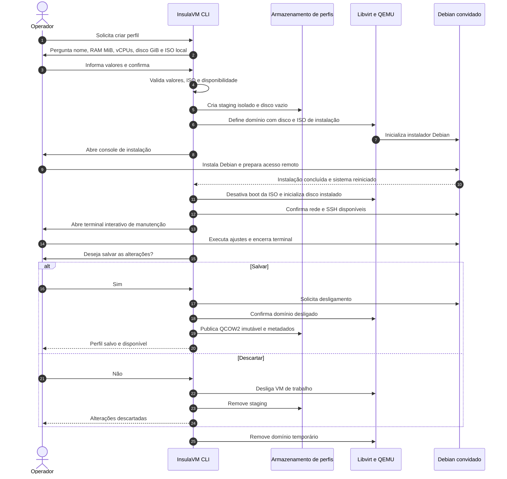

<!-- A-BIOMA-DOC-STANDARD -->
<!-- A-BIOMA-DOC-REVISADO -->

# FLUX-002 — Criação e publicação de perfil de VM

**Estado:** Proposto — não implementado.
**Versão aprovada:** nenhuma.
**Entrada:** operação interativa de criação de perfil na CLI.
**Interface de terminal:** [INTF-TERM-001](../interfaces/terminal/INTF-TERM-001-criar-perfil-vm.md).
**Armazenamento e decisões:** [ARQ-002](../arquitetura/ARQ-002-perfis-vm.md).
**Contrato canônico (proposto):** [CONTR-001 — CreateProfileFromISO](../contratos/CONTR-001-operacoes-canonicas.md).

## Objetivo

Criar um perfil de máquina Debian reutilizável por meio de ISO local, alocando RAM, núcleos de CPU e disco virtual (GiB) definidos pelo usuário, permitindo manutenção manual e oferecendo salvamento da imagem configurada ao sair do terminal. Cada Action futura deve trabalhar sobre clone descartável do perfil salvo, não na imagem original.

## Distinção entre criação por ISO e congelamento implementado

Este documento descreve **somente o fluxo interativo proposto** de instalar um sistema a partir de uma ISO convencional. O InsulaVM já implementa um caminho diferente: iniciar uma VM de perfil QCOW2 existente, preparar o sistema e **congelar** a VM por um nome novo, em [FLUX-004 — Congelar VM](FLUX-004-congelar-vm.md). Esse fluxo implementado não produz ISO Live e não substitui o instalador da distribuição.

## Pré-condições

- Aplicação InsulaVM com diretório de dados configurado e permissão de acesso ao Libvirt/KVM/QEMU.
- Usuário **já baixou** uma ISO Debian para a máquina hospedeira; neste ciclo **não** há download automático.
- O nome do perfil, RAM em **MiB**, quantidade de **vCPUs**, capacidade de disco em **GiB** e caminho **absoluto** da ISO são solicitados interativamente.
- O disco virtual deve ter capacidade positiva e viável para a instalação; a CLI e o método `CreateProfileFromISO` ainda não estão implementados.
- O operador pode acessar o console de instalação. O sistema recém-instalado precisa ser configurado para permitir manutenção SSH, quando aplicável.

## Diagrama de sequência

**Nota:** a criação de perfil é um fluxo **administrativo e interativo**, distinto da execução não interativa de Actions documentada em [FLUX-001](FLUX-001-execucao-manifesto.md).

## Sequência funcional

1. **Solicitar nome:** receber identificação legível para a VM/perfil e usá-la na subpasta de `profiles/` do diretório configurado. Rejeitar nomes que causem traversal ou colisão.
2. **Solicitar recursos:** ler RAM em **MiB** (não megabits), número inteiro positivo de vCPUs e capacidade positiva do disco virtual em **GiB**; verificar limites de configuração, espaço e capacidade do host.
3. **Solicitar ISO:** receber caminho local absoluto, conferir extensão/formato legível, integridade opcional por checksum e compatibilidade com arquitetura/firmware.
4. **Preparar ambiente:** reservar diretório temporário; criar disco QCOW2 modificável com a capacidade `DiskGiB` informada; montar ISO somente leitura; gerar XML e iniciar domínio Libvirt.
5. **Instalar sistema:** expor console serial ou gráfico de instalação para que o usuário instale Debian no disco. Caso exista automação de instalação com Preseed, usá-la somente quando efetivamente suportada; Cloud-Init sozinho não instala uma ISO Debian padrão.
6. **Primeiro boot pelo disco:** remover prioridade da mídia de instalação, iniciar o Debian instalado, preparar usuário de execução e chave pública, configurar SSH/rede e confirmar que a manutenção remota está disponível. Cloud-Init só se houver suporte instalado no convidado.
7. **Abrir manutenção:** iniciar terminal SSH com PTY, ligado a shell interativa do Debian, e permitir ajustes de pacotes, arquivos e configuração.
8. **Capturar saída do terminal:** quando o usuário encerra a shell, detectar o encerramento da sessão e **retomar a CLI**. Não confundir fechamento de PTY com desligamento da VM.
9. **Perguntar se deseja salvar:** aceitar confirmação explícita. Se **não**, encerrar e descartar disco de trabalho. Se **sim**, desligar convidado com segurança e esperar confirmação de parada.
10. **Publicar perfil:** verificar imagem, convertê-la para QCOW2 autônoma somente se necessário; salvar como versão imutável em `profiles/<nome>/versions/`, registrar metadados (nome, recursos, ISO de origem, versão e disco), e então torná-la disponível para Actions.
11. **Limpar recursos:** remover VM temporária, staging e credenciais efêmeras que não forem necessárias. Nunca apagar a ISO informada pelo usuário.

## Encerramentos anormais e recuperação

| Situação | Resultado planejado |
| --- | --- |
| Nome já cadastrado ou fora do padrão | Solicitar nome válido sem sobrescrever perfil |
| RAM/vCPUs/disco inválidos ou espaço insuficiente | Bloquear antes de provisionar |
| ISO ausente, ilegível ou incompatível | Não iniciar; pedir caminho válido |
| Instalação incompleta ou sem boot pelo disco | Não permitir publicação de perfil como pronto; oferecer correção/reinício ou descarte |
| SSH ainda indisponível | Exibir causa e permitir manutenção via console disponível |
| Terminal desconectado inesperadamente | Preservar staging temporariamente e oferecer reconexão; não salvar automaticamente |
| Usuário escolhe descartar | Encerrar domínio e remover apenas arquivos da sessão |
| Falha ao desligar ou publicar | Não marcar perfil como válido; preservar/limpar staging conforme política de recuperação |
| Interrupção do processo InsulaVM | Detectar staging órfão em execução posterior e oferecer recuperação/limpeza segura |

## Critérios de aceite futuro

- Nome, RAM (MiB), vCPUs, disco virtual (GiB) e ISO local são recebidos e validados.
- Pasta isolada é criada sob raiz de dados configurada, sem sobrescrita acidental.
- VM efetivamente inicia pela ISO selecionada e oferece acesso ao instalador.
- Após instalar, uma sessão de manutenção permite ajustes no sistema convidado.
- O encerramento do terminal aciona pergunta de salvamento sem assumir que VM já está desligada.
- Resposta afirmativa produz imagem QCOW2 consistente e metadados; negativa descarta apenas o temporário.
- Um Action posterior usa overlay de imagem-base, sem modificar o perfil e com limpeza no final.
- Casos de cancelamento, falha de disco, SSH e desligamento são cobertos por testes quando houver implementação.

## Referências

- [ARQ-002 — Perfis e overlays](../arquitetura/ARQ-002-perfis-vm.md)
- [INTF-TERM-001 — Criação pelo terminal](../interfaces/terminal/INTF-TERM-001-criar-perfil-vm.md)
- [FLUX-001 — Actions e pipelines](FLUX-001-execucao-manifesto.md)
