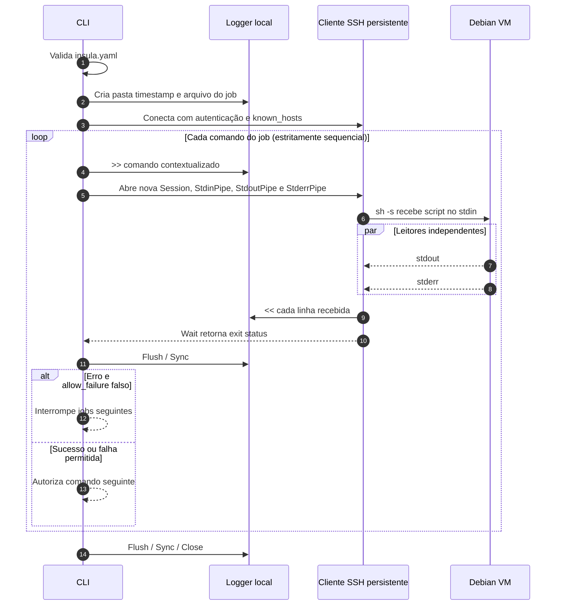

<!-- A-BIOMA-DOC-STANDARD -->
<!-- A-BIOMA-DOC-REVISADO -->

# FLUX-003 — Execução sequencial e logs SSH por job

**Estado:** implementado para comandos SSH, logs e execução por manifesto em VM gerenciada ou host externo. **Checkout Git automático:** não implementado.
**Versão aprovada:** nenhuma.
**Fontes de código:** [pkg/executor/ssh.go](../../pkg/executor/ssh.go), [pkg/storage/logger.go](../../pkg/storage/logger.go), [pkg/manifest/manifest.go](../../pkg/manifest/manifest.go) e [main.go](../../main.go).
**Fluxo da Action com manifesto (implementado):** [FLUX-001](FLUX-001-execucao-manifesto.md).

## Objetivo e entrada

Para cada job definido em `insula.yaml`, gravar todos os comandos enviados e as linhas recebidas em arquivo físico, na máquina hospedeira. Executar somente **um comando por vez**, respeitando o resultado remoto antes de iniciar o seguinte.

A CLI pode iniciar uma VM descartável de um perfil QCOW2 via Libvirt e Cloud-Init, ou conectar-se a host SSH externo com credenciais preexistentes. Em VMs gerenciadas, o diretório `guest.destination` é preparado automaticamente; um `workspace` personalizado precisa existir e ser acessível. O checkout Git automático permanece não implementado.

## Localização dos logs

```text
<logs-root>/<repositorio>/<action-ou-pipeline>/<YYYYMMDD_HHMMSS>/<job>.log
```

- `storage.logs` em `config.yaml`: raiz padrão de logs no hospedeiro; `run -logs-root` pode sobrescrever essa localização. Não há exigência de variável `INSULA_LOG_ROOT` no parser atual.
- `repository.name`: nome validado e seguro para caminhos.
- `action`: nome do agrupamento de execução. Quando ausente, usa `pipelines[0].name` se houver exatamente uma pipeline.
- Data e hora: instante de início local, até os segundos. Colisões no mesmo segundo recebem sufixo `_001`, `_002` etc., sem sobrescrever uma execução anterior.
- `job.name`: arquivo exclusivo; nomes duplicados entre pipelines são rejeitados pela validação. `setup` gera `setup.log` quando configurado.

Os arquivos recebem permissões `0600` e as pastas criadas pelo processo, `0700`. Os logs permanecem após a execução: não há rotina de retenção automática neste ciclo.

## Diagrama de execução



**Detalhe importante:** o cliente SSH autenticado é reutilizado durante a execução; a **sessão SSH é renovada por comando**. A API `ssh.Session` do Go aceita apenas um `Start` ou `Run` por sessão. Esse desenho permite obter o exit status individual de cada comando e ainda evita reconexões TCP/SSH sucessivas.

## Regras de entrada e retorno

- `>> `: precede cada linha do comando enviado à VM, inclusive o prefixo `cd '<workspace>' &&`.
- `<< `: precede cada linha de `stdout` ou `stderr`, incluindo linhas vazias.
- A gravação ocorre com `bufio.Writer`, `Flush` a cada linha e sincronização em disco ao fim de cada comando e ao fechar o arquivo.
- O terminal apresenta as linhas com o nome do job. Saídas `stderr` recebem marcador adicional no **terminal**, não dentro do arquivo (ambos usam `<<`).
- Como stdout e stderr são lidos concorrentemente, a ordem de chegada entre os dois canais **não tem garantia global**; a ordem dentro de cada canal é preservada.
- Com `allow_failure: false`, retorno remoto não zero interrompe o job e os jobs posteriores.
- Com `allow_failure: true`, retornos remotos não zero são tolerados **apenas** para aquele job; falhas de conexão, leitura ou gravação continuam fatais.
- Cancelamento e timeout fecham a sessão remota; a conexão SSH compartilhada é encerrada ao final da CLI.

## Limites e segurança

- Os nomes de repositório, agrupamento e job são validados antes do uso em caminhos. A execução não sobrescreve arquivos de logs existentes.
- A chave do servidor remoto deve estar previamente confiável no arquivo `known_hosts`; não há desativação de verificação de host key.
- Os comandos do YAML são enviados à shell remota e são **código executável**; só use manifestos confiáveis. Scripts e saídas podem conter segredos que serão persistidos literalmente; mascaramento de credenciais e retenção de logs são melhorias pendentes.
- Linhas extremamente longas são preservadas pelo leitor `bufio.Reader` sem limite de 64 KiB do scanner padrão. Linhas sem quebra de linha são emitidas ao final.
- Sessões separadas não mantêm variáveis de ambiente ou alterações de `cd` entre comandos. Cada comando inicia explicitamente no `workspace` configurado.

## Interface e exemplos

Ver [INTF-TERM-002](../interfaces/terminal/INTF-TERM-002-executar-manifesto.md) e [insula.yaml.example](../../insula.yaml.example).

## Critérios verificáveis

1. Um arquivo por job com marcadores `>>`/`<<`.
2. Execução com tempo e caminhos no padrão documentado.
3. Um comando não pode iniciar antes de `Wait` do anterior.
4. `allow_failure` permite apenas continuar após erro remoto de status.
5. Os testes unitários e de integração SSH em `pkg/storage`, `pkg/manifest` e `pkg/executor` cobrem os cenários centrais.
