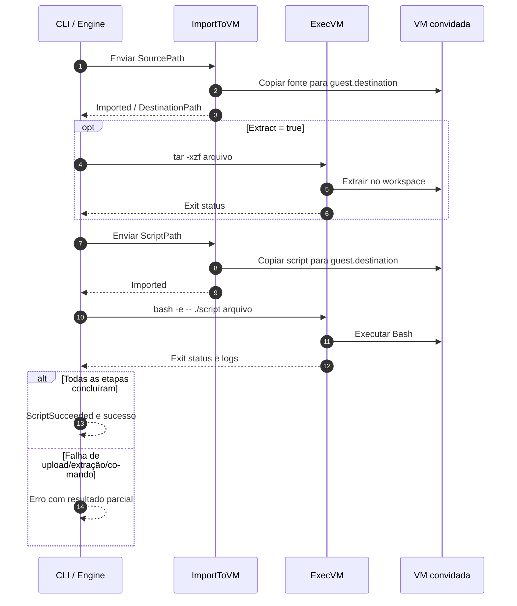

<!-- A-BIOMA-DOC-STANDARD -->
<!-- A-BIOMA-DOC-REVISADO -->

# FLUX-005 — Envio e execução de script em VM gerenciada

**Estado:** implementado.
**Versão aprovada:** nenhuma.
**Código canônico:** [DeployToVM](../../insulavm/deploy.go), [ImportToVM](../../insulavm/import_vm.go), [ExecVM](../../insulavm/exec.go).
**Interface CLI:** [INTF-TERM-005](../interfaces/terminal/INTF-TERM-005-deploy-vm.md).

## Objetivo

Enviar um arquivo local e um script Bash para uma VM já ativa, opcionalmente extrair um pacote TAR.GZ e executar o script no diretório `guest.destination`. Sucesso é retornado apenas quando **todas as etapas solicitadas** concluírem sem erro.

## Entradas e pré-condições

`VMDeployRequest` inclui `VMID`, `SourcePath`, `ScriptPath`, `Extract`, `Sudo`, `Output` e `CommandTimeout`. O arquivo fonte e o script devem ser arquivos regulares locais, sem links simbólicos, com nomes-base distintos. `Extract` aceita somente `.tar.gz`/`.tgz`, fornecidos por origem confiável. O contexto deve estar ativo e a VM constar como em execução no Libvirt e SQLite.

## Sequência

## Regras

1. Validar caminhos, tipos e extensões antes de enviar.
2. Importar a fonte e, quando solicitado, executar `tar -xzf` dentro de `guest.destination`.
3. Importar o script e executá-lo com `bash -e -- ./<script> <nome-base-do-arquivo>`; o primeiro argumento (`$1`) contém o nome do arquivo enviado.
4. `Sudo` usa `sudo -n` quando a VM foi criada com essa permissão.
5. Falha interrompe as etapas seguintes. `VMDeployResult` informa quais fases já concluíram; o caminho de logs é retornado quando houver execução remota.
6. O arquivo TAR.GZ permanece após extração. Não há rollback de arquivos já enviados, descompactados ou criados pelo script.

Para scripts com pipelines, recomenda-se `set -euo pipefail` no próprio script; o `bash -e` usado pelo chamador, isoladamente, não cobre todas as situações de erro.

## Erros e segurança

| Situação | Tratamento |
| --- | --- |
| Fonte/script ausente, link simbólico, pasta ou mesmo nome-base | Falha antes de qualquer upload |
| `-extract` com formato diferente de TAR.GZ/TGZ | Falha de validação |
| VM offline ou sem SSH | Falha de importação ou execução; operação não é bem-sucedida |
| Extração/execução retorna status não zero | Erro, parada imediata, logs se produzidos |
| `sudo` indisponível | Falha; não solicita senha interativa |

Arquivos e scripts executam código no convidado. Não envie arquivos TAR.GZ de origem não confiável e não inclua segredos em comandos ou saídas. A execução de comandos não implica proteção automática contra scripts maliciosos.

## Resultado

`DeployToVM` retorna `(*VMDeployResult, error)`. A CLI imprime `DEPLOY SUCCESS` e sai com código `0` somente quando o método não retornar erro. Consulte [INTF-TERM-005](../interfaces/terminal/INTF-TERM-005-deploy-vm.md) para flags e saída.

## Referências

- [ARQ-005 — Importação por SSH](../arquitetura/ARQ-005-importacao-arquivos.md)
- [FLUX-003 — Logs e execução sequencial](FLUX-003-execucao-sequencial-logs.md)
