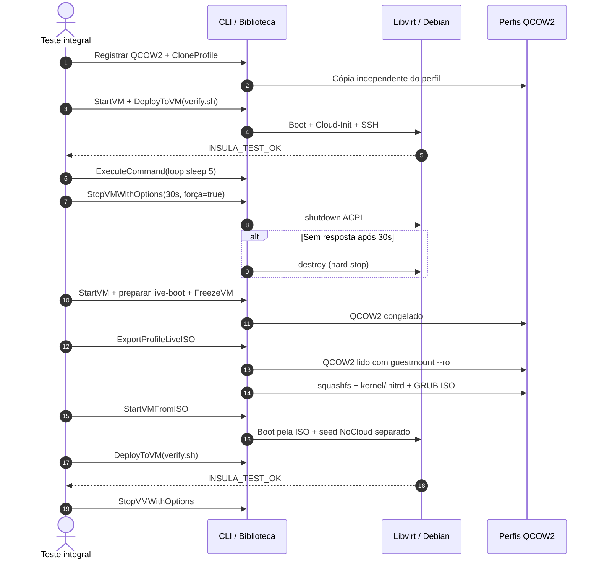

<!-- A-BIOMA-DOC-STANDARD -->
<!-- A-BIOMA-DOC-REVISADO -->

# FLUX-006 — Teste integral de VM e ISO Live

**Estado:** implementação inicial disponível em branch de trabalho; execução KVM real **não verificada**.
**Versão aprovada:** nenhuma.
**Contratos:** [CONTR-001](../interfaces/CONTR-001-operacoes-canonicas.md) e [CONTR-002](../interfaces/CONTR-002-transporte-stdio.md).
**Interfaces:** [INTF-TERM-006](../interfaces/terminal/INTF-TERM-006-iso-live.md).
**Guia:** [GUIA-003](../guias/GUIA-003-testes.md).

## Objetivo

Reutilizar uma VM Debian 13 por nome, gerar uma ISO Live inicializável a partir do conteúdo do perfil QCOW2 e provar que a ISO inicia uma VM com Cloud-Init/SSH capaz de executar um script que retorna INSULA_TEST_OK. Não confundir a ISO NoCloud (configuração) com ISO Live (sistema operacional) ou ISO netinst (instaladora).

## Entradas e pré-condições

- Hospedeiro Linux x86_64 com KVM, Libvirt, rede DHCP, Go 1.23+, qemu-img, virsh e SSH.
- Base QCOW2 Debian 13 **já instalada**, com SSH, Cloud-Init, sudo sem senha e acesso à rede.
- ISO Live: guest Debian tem live-boot e initramfs reconstruído após a instalação; hospedeiro tem guestmount, guestunmount, mksquashfs, lsinitramfs, grub-mkrescue, GRUB BIOS/UEFI e xorriso.
- O teste integral usa um config.yaml próprio para testes e deve rodar em host dedicado.
- O pipeline para instalar Debian automaticamente **a partir da ISO netinst** ainda não está implementado: CreateProfileFromISO permanece proposto. Para iniciar a suíte atual, fornecer QCOW2 Debian preparado.

## Diagrama de sequência

## Regras de execução

1. Registrar e clonar perfis sem alterar imagem de origem.
2. Executar comandos por SSH na VM e validar **o marcador retornado pelo convidado**, nunca apenas o exit code de um comando do host.
3. Iniciar um laço infinito com sleep de cinco segundos, enviando sua saída para arquivo remoto, para o SSH não ficar preso aos descritores do processo em segundo plano.
4. Solicitar shutdown gracioso com prazo de 30 segundos. Somente se o prazo expirar, usar virsh destroy. Erro de acesso ao Libvirt **não** autoriza forçar VM de identidade incerta.
5. Criar imagem nomeada por FreezeVM, que remove a VM de origem após a publicação. Testes nunca devem congelar uma VM com dados importantes.
6. Converter o filesystem de um QCOW2 somente com guestmount read-only. Validar kernel e initramfs com live-boot antes de gerar ISO. Publicar ISO atomicamente em profiles/<nome>/exports/<nome>-live.iso.
7. Iniciar a ISO como mídia de boot, com seed NoCloud e disco scratch próprios da instância, aguardar DHCP/SSH e executar verify.sh. Uma ISO que apenas exista no host **não** prova o boot.
8. Realizar cleanup de VMs iniciadas, inclusive no erro. Os perfis do teste recebem nomes exclusivos e permanecem para inspeção após a suíte.

## Cenários obrigatórios

| Cenário | Critério de sucesso |
| --- | --- |
| Teste unitário | Go test -race e go vet terminam sem falha |
| Alpine ISO oficial obrigatória | Alpine Virtual 3.24.4 inicializa com 1 vCPU/500 MiB, comando real via ttyS0 retorna marcador/exit 0, `poweroff` remove domínio transitório |
| CloneProfile | Novo nome resolve um QCOW2 próprio |
| Inicialização QCOW2 | Libvirt ativo, IP DHCP e SSH autenticado |
| Upload e script | Saída contém INSULA_TEST_OK |
| Processo infinito | Start em background; StopVMWithOptions termina e estado Libvirt é absent |
| Congelamento | Perfil nomeado e QCOW2 autônomo publicados |
| ISO Live | Exportação contém squashfs, kernel, initrd e GRUB; guest inicia por CDROM |
| Execução dentro da ISO | DeployToVM devolve INSULA_TEST_OK |
| Desligamento ISO | Instância e armazenamento temporário removidos |

## Cenário Alpine independente

O `scripts/tests/alpine-iso.sh` verifica a ISO Alpine Virtual oficial sem depender de perfil QCOW2, rede DHCP, Cloud-Init ou SSH. Sua execução é parte obrigatória de `scripts/tests/integration.sh` e não é afetada pelas flags de exclusão dos cenários Debian. O teste é implementado em `tests/integration/alpine_iso_test.go`, isolado do motor de VMs gerenciadas (sem novas operações públicas CLI/Go), e gera evidências em `storage.logs`. Comprovar esse boot **não** valida o boot das ISOs Live geradas pelo InsulaVM; ambos os cenários permanecem necessários.

## Limitações e falhas

- A documentação e os testes não significam que a suíte tenha sido executada com KVM neste ambiente.
- Instalação de SO por Debian netinst via CreateProfileFromISO é evolução separada. Não executar uma ISO netinst usando StartVMFromISO: esta função exige ISO **Live com Cloud-Init**.
- O shutdown não tem SLA absoluto de 30 segundos para conclusão total; o prazo de 30 segundos controla a **escalada**. Libvirt e limpeza podem consumir tempo adicional.
- FreezeVM remove identidade SSH/Cloud-Init de instância, mas não limpa segredos de aplicativos.
- Live ISO é normalmente imutável: alterações no convidado exigem persistência externa.
- O teste exige ambiente apto a instalar live-boot; sem rede/pacotes falha explicitamente.

## Evidências

- [stop_policy.go](../../insulavm/stop_policy.go), [profile_clone.go](../../insulavm/profile_clone.go), [export_iso.go](../../insulavm/export_iso.go)
- [live_iso.go](../../insulavm/live_iso.go), [vm/live_iso.go](../../pkg/vm/live_iso.go)
- [integration.sh](../../scripts/tests/integration.sh) e [unit.sh](../../scripts/tests/unit.sh)

## Cenário obrigatório: shutdown forçado de VM resistente

O teste `guest/ignore-shutdown.sh` configura `systemd-logind` para ignorar ACPI power button e mascara `poweroff.target` durante a sessão descartável. O `loop.sh` executa `while :; do sleep 5; done`. A CLI envia shutdown gracioso com 30 segundos e somente após o timeout pode usar `virsh destroy`. O aceite exige `forced=true`, `timed_out=true`, domínio `absent`, e pelo menos 29 segundos medidos pelo Bash; shutdown gracioso precoce **não** é aceito nesse cenário. O unitário `insulavm/stop_adapter_test.go` confirma ordem real de comandos sob Libvirt simulado e SQLite real com prazo abreviado.

## Integração direta da biblioteca Go

Por padrão, o teste integral executa também `tests/integration/engine_test.go`, com build tag `integration`, validando a API pública in-processo, incluindo operações de VM, importação/deploy, freeze, exportação de ISO e boot. Em CI sem KVM esse teste é apenas compilado, não executado. `--skip-go-api` limita a suíte ao transporte CLI.
