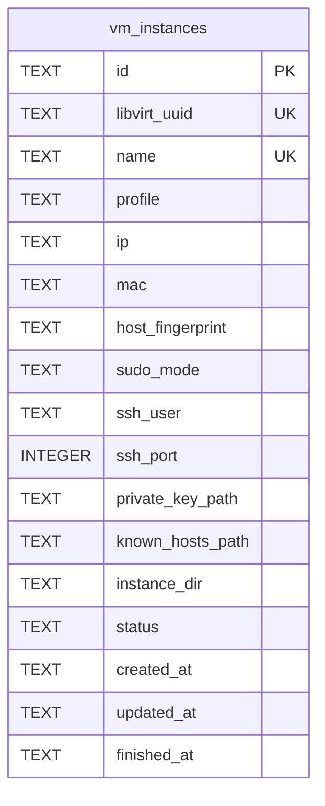
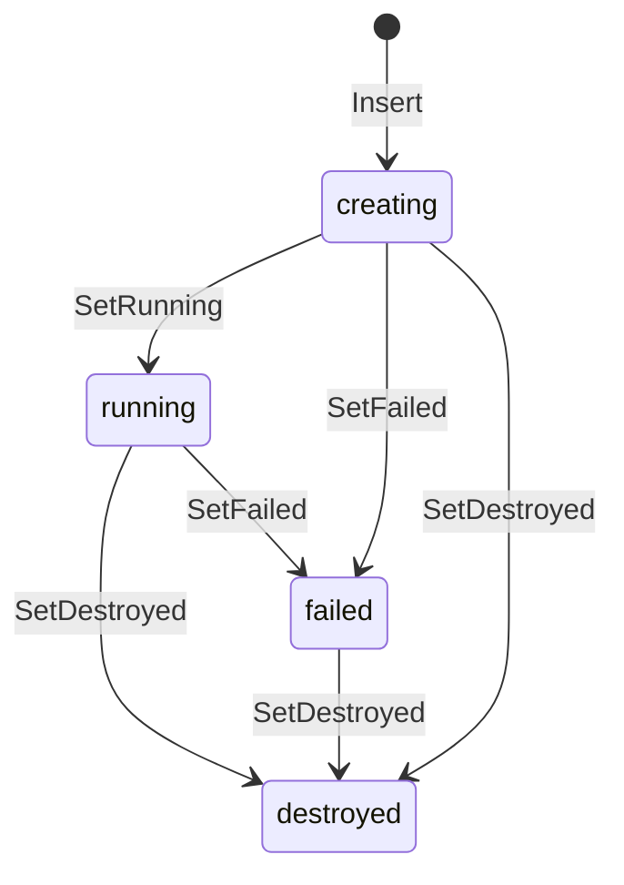

<!-- A-BIOMA-DOC-STANDARD -->
<!-- A-BIOMA-DOC-REVISADO -->

# PERS-001 — Registro SQLite de instâncias gerenciadas

**Estado:** implementado. Fonte canônica: [`pkg/registry/sqlite.go`](../../pkg/registry/sqlite.go).
**Escopo:** metadados persistentes de instâncias de VM; não é o catálogo de imagens QCOW2.

## Banco e tabela

O arquivo SQLite é definido por `storage.database` em [config.yaml](../../config.yaml); por padrão fica em `storage.root/insula.db`. A tabela `vm_instances` armazena histórico das instâncias que o InsulaVM iniciou. O banco utiliza WAL e `busy_timeout=10000`. As chaves privadas são guardadas **como caminhos**, nunca como conteúdo no banco.

### Colunas reais do schema

| Coluna | Tipo | Obrigatória / origem |
| --- | --- | --- |
| `id` | TEXT, PK | UUIDv7 gerado pela aplicação |
| `libvirt_uuid` | TEXT, UNIQUE | UUID do domínio criado no Libvirt |
| `name` | TEXT, UNIQUE | Nome do domínio `insula-...` |
| `profile` | TEXT | Nome do perfil de imagem-base selecionado |
| `ip` | TEXT | Padrão `''`, atualizado quando DHCP é confirmado |
| `mac` | TEXT | Endereço MAC gerado para instância |
| `host_fingerprint` | TEXT | Impressão digital da chave SSH do convidado |
| `sudo_mode` | TEXT | Modo de elevação configurado |
| `ssh_user` | TEXT | Conta SSH provisionada |
| `ssh_port` | INTEGER | Padrão 22 |
| `private_key_path` | TEXT | Caminho da chave privada de cliente no hospedeiro |
| `known_hosts_path` | TEXT | Caminho de `known_hosts` do hospedeiro |
| `instance_dir` | TEXT | Diretório temporário de disco/seed e credenciais |
| `status` | TEXT | `creating`, `running`, `failed` ou `destroyed` |
| `created_at` | TEXT | Instante UTC no formato RFC3339Nano |
| `updated_at` | TEXT | Última alteração UTC RFC3339Nano |
| `finished_at` | TEXT | Padrão `''`; instante UTC de finalização quando aplicável |

Todas as colunas são `NOT NULL`. `status` possui restrição `CHECK`. Existe índice `vm_instances_by_status(status, created_at)`. Não há FK para perfis: o nome `profile` referencia logicamente o catálogo em arquivos `profile.yaml`.

## Ciclo de vida

Os métodos `Insert`, `SetRunning`, `SetFailed` e `SetDestroyed` são a fonte de verdade dos estados **registrados**. O estado efetivo é consultado separadamente no Libvirt via [`pkg/vm/status.go`](../../pkg/vm/status.go). O valor `running` do SQLite sozinho **não comprova** que o domínio esteja ativo.

## Relações e consumo

| Consumidor | Dados necessários | Comportamento |
| --- | --- | --- |
| `vm list` / `vm status` | `id`, `name`, `profile`, `ip`, `status`, `libvirt_uuid` | Combina registro e consulta ao Libvirt |
| `vm exec` / `vm import` / `vm deploy` | `id`, `ip`, `ssh_port`, `ssh_user`, caminhos SSH | Localiza destino e credenciais da VM gerenciada |
| `vm stop` / `vm stop-all` | `id`, `libvirt_uuid`, `instance_dir`, `status` | Reconfirma domínio e remove recursos temporários |
| `vm freeze` | `id`, `profile`, `sudo_mode`, `instance_dir` | Confirma origem e captura disco em novo perfil |

`StopAllVMs` usa **apenas registros desta tabela**, nunca VMs externas não registradas. Perfis congelados são armazenados no filesystem sob `storage.profiles`; não criam uma tabela SQL adicional.

## Migração e limitações

A inicialização aplica migrações aditivas para as colunas `host_fingerprint`, `sudo_mode` e `ssh_port` em bancos antigos. Não existe reconciliação automática de divergências SQLite/Libvirt ao iniciar o motor. Após remoção da VM, o histórico permanece no banco, mas os arquivos de credenciais e o overlay temporário são descartados.

## Evidências

- [Schema e operações SQLite](../../pkg/registry/sqlite.go)
- [Consulta real de estado](../../pkg/vm/status.go)
- [Gerenciamento de ciclo de vida](../../pkg/vm/runtime.go)
